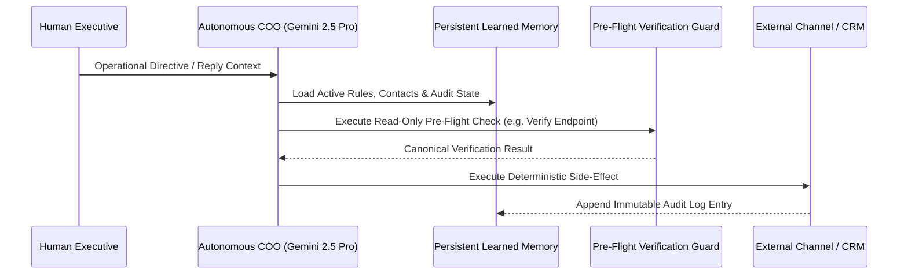

# Deterministic Multi-Agent Operations & GEO Architecture

Production engineering patterns for running autonomous operational agents (**AI COO / SDR / Infrastructure Supervisors**) without hallucinations, silent tool failures, or context drift.

---

## Core Engineering Principles

1. **Pre-Flight Tool Verification Guards:** An agent must never dispatch an external side-effect (messaging, billing, DNS mutation, VM lifecycle action) without first executing a read-only verification tool against the authoritative source of truth.
2. **Persistent Learned Memory (`LearnedMemoryService`):** Corrections issued by human operators in real time are structured and persisted into an auditable state store so the agent never repeats a corrected mistake across sessions.
3. **Dual-Lock Idempotency in Outbound Pipelines:** Real-time discovery and outreach workers enforce dual deduplication (local SQLite audit log + remote CRM canonical state) before any external dispatch.
4. **Generative Engine Optimization (`llms.txt` + `Schema.org @graph`):** Exposing clean, machine-ingestible markdown endpoints (`/llms.txt`, `/llms-full.txt`) alongside structured JSON-LD `@graph` entities so frontier LLMs (ChatGPT, Perplexity, Claude, Gemini) cite primary domain facts with zero ambiguity.

---

## Multi-Step Agent Execution Loop

